# Maak je eigen controller

**⌨️ Toetsenbord · 🖱️ Muis · 🎹 MIDI-controller · 🎮 Gamepad**

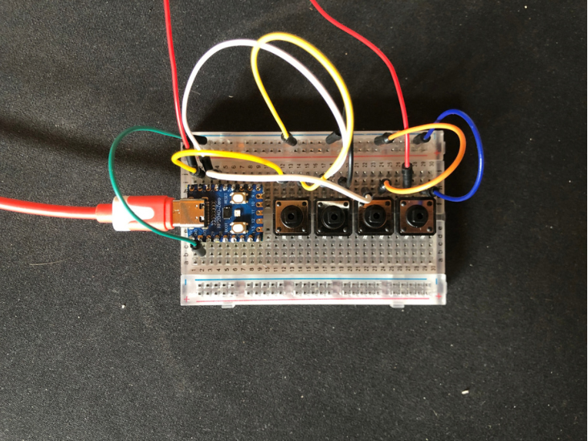

## Overzicht per niveau

Elke kolom is een niveau. Een blok dat over meerdere kolommen loopt, doen die niveaus samen. Lees van boven naar beneden en klik op een blok om de stap te openen.

 

<a href="./stappen/01-stroomkring/README.md">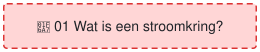</a> 
 
 
<a href="./stappen/04-bord-opzetten/README.md#microbit-als-hid">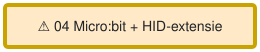</a><a href="./stappen/04-bord-opzetten/README.md#wired-pro-micro-with-hid-project">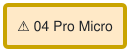</a><a href="./stappen/04-bord-opzetten/README.md#wireless-esp32-with-bluetooth-ble">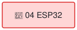</a> 
 
 
<a href="./stappen/07-eigen-input/README.md">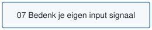</a> 
 
<a href="./stappen/09-circuit-simuleren/README.md">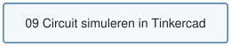</a> 
 
<a href="./stappen/11-code/README.md#pro-micro-hid-project">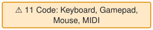</a> 
 
<a href="./stappen/13-tinkercad/README.md#een-bestaand-ontwerp-pimpen-soldeerloos">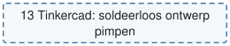</a> 
<a href="./stappen/14-eigen-3d-pakket/README.md">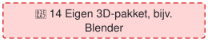</a> 
 
<a href="./stappen/16-bedrading/README.md#draadjes-op-maat-knippen">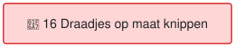</a> 

Stippellijn = optioneel. Dikke gele rand (stap 04) = keuzemoment voor je bord; vanaf daar verschillen de code en de voorbeelden per bord.

🚧 Rood = nog geen lesmateriaal. ⚠️ Oranje = deels af.

## Keuzes en routes

Dit schema laat alleen de **keuzes** zien en waar de routes weer samenkomen. Een stippellijn betekent: dit mag ook, als je meer (of minder) uitdaging zoekt.

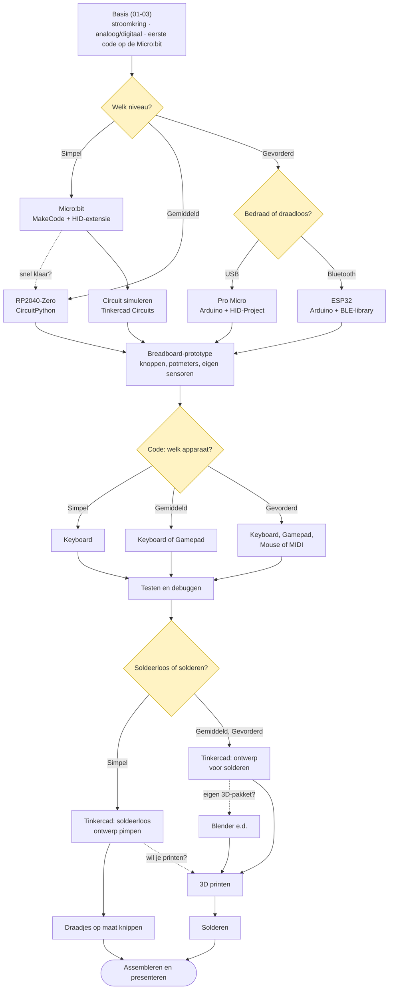

## Bronnen

Deze leerlijn combineert:

- [Piece-of-Code-Game-Workshop](https://github.com/CreativeCodingUtrecht/Piece-of-Code-Game-Workshop) (Week 2, 3, 5, 6)
- DAT-Hackathon-2k25 (Arduino-voorbeelden, Engelstalig)
- Het werkboekje *Maak je eigen gamecontroller* ([boekje/](./boekje/README.md))

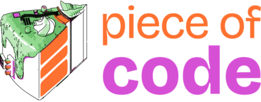

## Licentie

Dit lesmateriaal valt onder de [Creative Commons Naamsvermelding 4.0 Internationaal](https://creativecommons.org/licenses/by/4.0/deed.nl) (CC BY 4.0), **tenzij anders vermeld**. Je mag het delen en aanpassen, ook in je eigen lessen, zolang je de bron vermeldt. De volledige tekst staat in [LICENSE](./LICENSE).

De code (`*.py`, `*.ino` en de scripts in `scripts/`) valt onder de [MIT-licentie](./LICENSE-CODE).

Een deel van de CircuitPython-code komt van Adafruit en valt ook onder MIT, met Adafruit als rechthebbende:

- de library `adafruit_hid/` in `stappen/11-code/circuitpython/` ([Adafruit_CircuitPython_HID](https://github.com/adafruit/Adafruit_CircuitPython_HID), licentie staat in de map)
- bestanden met een eigen `SPDX`-regel bovenaan, zoals `hid_gamepad.py` en de voorbeelden in `code.py`

De Arduino-voorbeelden gebruiken de libraries [HID-Project](https://github.com/NicoHood/HID) en [IRremote](https://github.com/Arduino-IRremote/Arduino-IRremote). Die zitten niet in deze repository; je installeert ze zelf via de Library Manager.

### Materiaal van derden

Sommige afbeeldingen (zoals foto's van borden en chips) zijn **niet** van ons. Daar staat onder de afbeelding dat ze niet onder CC BY 4.0 vallen. Ze blijven eigendom van hun makers en staan hier alleen ter illustratie. Wil je het materiaal hergebruiken, vervang deze afbeeldingen dan of vraag de rechthebbende om toestemming.

Logo's en merknamen (zoals Micro:bit, Raspberry Pi, Arduino en het Piece of Code-logo) zijn van hun eigenaars. Screenshots van software (MakeCode, Tinkercad, Arduino IDE, slicers) tonen het werk van de makers van die software.

Ben je rechthebbende en wil je dat iets wordt aangepast of verwijderd? Neem dan contact met ons op.
