# Maak je eigen gamecontroller

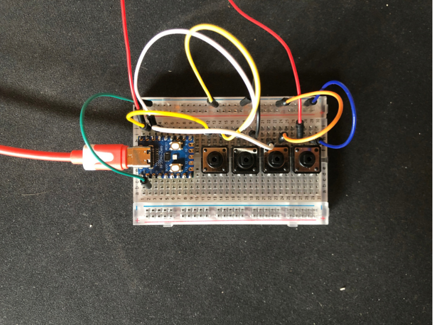

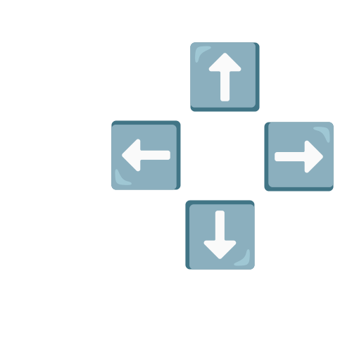

Dit boekje is van: ______________________

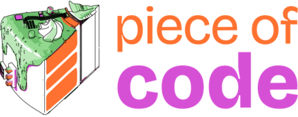

> Dit is de Markdown-versie van het werkboekje (oorspronkelijk gemaakt in Canva door Joost Welling).
> Les 1 gebruikt de Micro:bit, les 2 en 3 de RP2040-Zero.
> Zie de [leerlijn](../README.md) voor het overzicht.

---

## Voorbeelden

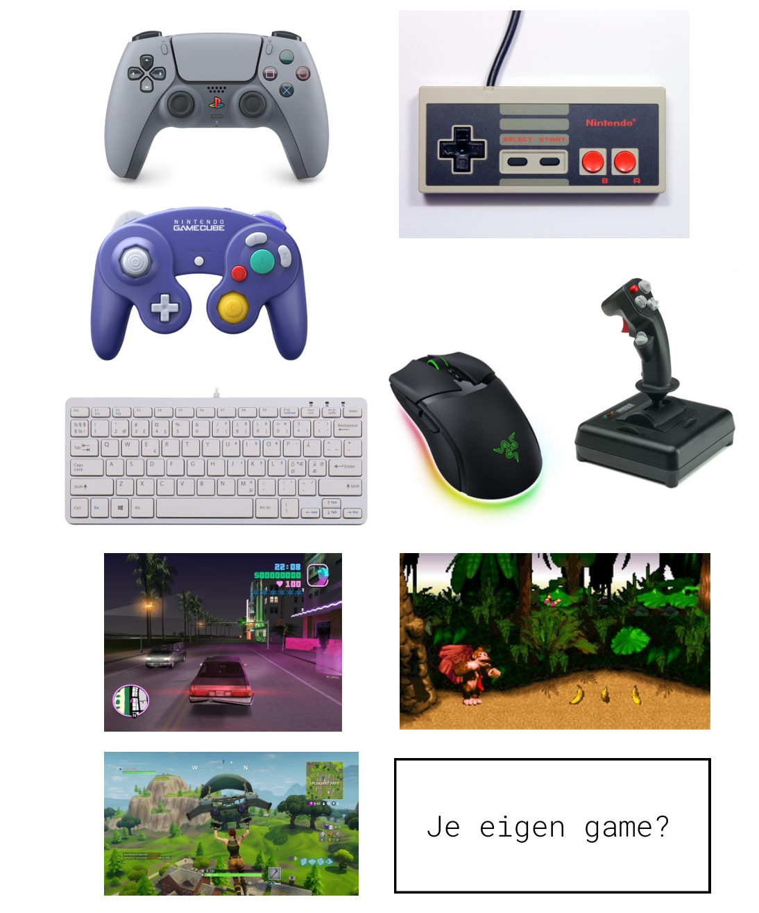

Je eigen game?

---

## Les 1 - Micro:bit

### De Micro:bit programmeren

👁️‍🗨️ Gebruik de Google Chrome browser

👁️‍🗨️ Stel de taal van de editor in op Engels

1️⃣ Ga naar: <https://makecode.microbit.org/>

2️⃣ Kies "New Project" en geef het een naam.

3️⃣ Ga naar: <https://microbit.org/projects/make-it-code-it/>

4️⃣ Maak de twee tutorials: "Heart" en "Beating heart".

❓ Wat doen volgens jou de "on start" en "forever" blokjes?

| Blokje | 📝 Wat doet het? |
| --- | --- |
| 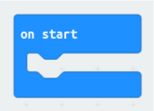 | |
| 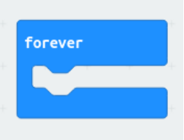 | |

### Code flashen - Hoe zet je de code op de Micro:bit?

1️⃣ Klik op "download" in de Micro:bit omgeving. Je download nu jouw project naar de computer.

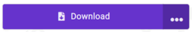

2️⃣ Sluit nu de Micro:bit aan op de computer met de USB-kabel.

3️⃣ Ga naar de File Explorer van je computer. Kopieer je bestand (`.hex`) naar de Micro:bit (usb). (Meestal vind je dit bestand in jouw Download-map.)

4️⃣ Het bestand is nu op de Micro:bit geplaatst en voorziet de computerchips op de Micro:bit van instructies.

❓ Reageert de Micro:bit op jouw code?

- **Ja!** Mooi, nu kun je meer functies toevoegen aan de Micro:bit.
- **Nee?**
  - Controleer de code stap voor stap en probeer het opnieuw.
  - Herkent de computer de Micro:bit als USB-apparaat?

🤖 **Extra**

- Wat zie je als je het hex-bestand opent als tekstbestand?
- Kun je jouw code ook plaatsen via web-usb? (Download > Pair..)

### Analoog en Digitaal

📖 Gamecontrollers maken gebruik van digitale en analoge signalen. We gaan nu onderzoeken wat dit voor signalen zijn. En hoe deze signalen van elkaar verschillen.

#### Een knop (push button) programmeren

1️⃣ Ga naar deze website: <https://www.teachwithict.com/pushbtton.html>

2️⃣ Volg de instructies om een knopje aan te sluiten op de Micro:bit.

3️⃣ Programmeer het knopje. Gebruik het voorbeeld of geef het zelf een functie!

#### Een potentiometer programmeren

1️⃣ Ga naar deze website: <https://www.teachwithict.com/potentiometer.html>

2️⃣ Volg de instructies om een potentiometer aan te sluiten op de Micro:bit.

3️⃣ Programmeer de potentiometer. Gebruik het voorbeeld of jouw creativiteit!

🤖 **Extra**

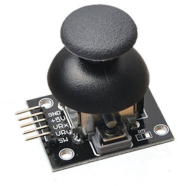

Afbeelding van derden. Valt niet onder de CC BY 4.0-licentie van dit materiaal.

Wat voor signaal heeft deze joystick?

- A) Analoog
- B) Digitaal
- C) Analoog & Digitaal

---

## Les 2 - Prototype

💡 **Belangrijk uit de vorige les...**

- De Micro:bit is een computer (hardware)
- Op de website kun je de Micro:bit programmeren (software)
- Het programma kun je downloaden naar de Micro:bit (via usb)

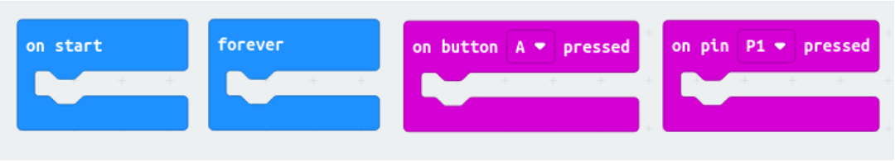

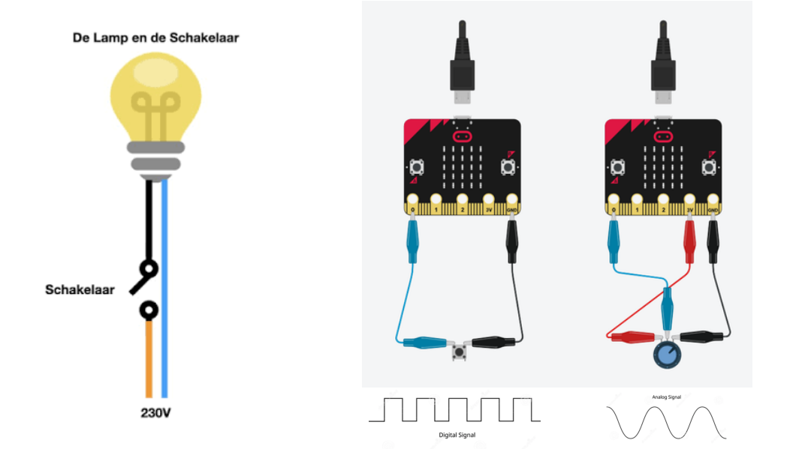

[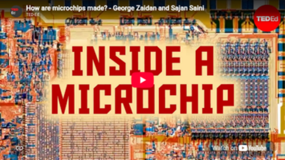](https://www.youtube.com/results?search_query=How+are+microchips+made+George+Zaidan+Sajan+Saini)

Afbeelding: TED-Ed. Valt niet onder de CC BY 4.0-licentie van dit materiaal.

### De processor (RP2040-Zero)

De 🧠 van de controller..

| 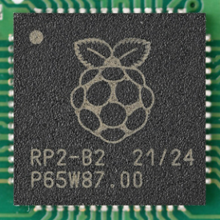 | 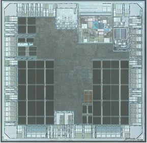 | 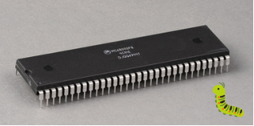 |
| --- | --- | --- |
| Dit is de processor | Zo ziet het er van binnen uit 🐛 | Voorbeeld: Motorola 68000 (1979) |

Afbeeldingen van derden. Vallen niet onder de CC BY 4.0-licentie van dit materiaal.

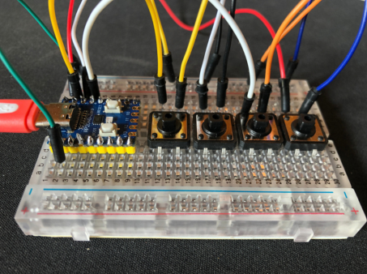

*De eerste gamecontroller (het prototype)*

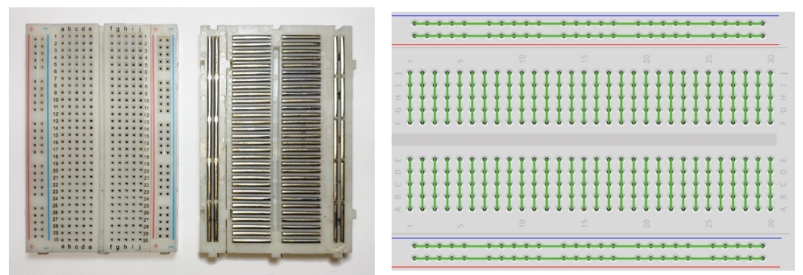

Afbeelding van derden. Valt niet onder de CC BY 4.0-licentie van dit materiaal.

👁️‍🗨️ Hier kun je zien hoe de gaatjes op het bordje (breadboard) zijn verbonden.

❗️ Let er op bij het aansluiten van de draadjes dat ze elkaar niet overbruggen.

### Onderzoek

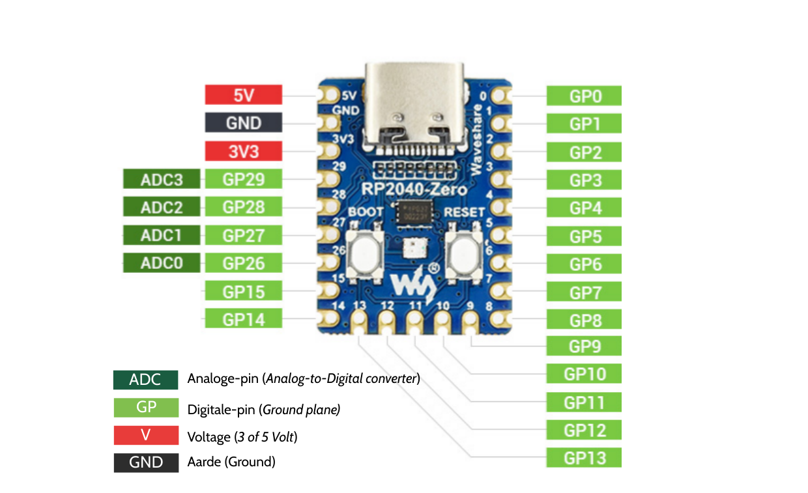

Gebaseerd op de pinout van Waveshare. Valt niet onder de CC BY 4.0-licentie van dit materiaal.

👁️‍🗨️ Kijk naar de legenda:

| Label | Betekenis |
| --- | --- |
| **ADC** | Analoge pin (*Analog-to-Digital Converter*) |
| **GP** | Digitale pin (*General Purpose* input/output) |
| **V** | Voltage (3 of 5 Volt) |
| **GND** | Aarde (*Ground*) |

1. Welke pinnen kun je gebruiken om de **analoge** besturing aan te sluiten?
   📝 ______________________
2. Welke pinnen kun je gebruiken om de **digitale** besturing aan te sluiten?
   📝 ______________________
3. Welke pin gebruik je om stroom op de Raspberry te zetten?
   📝 ______________________
4. Hoe kun je ook stroom op de Raspberry zetten?
   📝 ______________________

### Aan de slag!

1️⃣ Begin met het bouwen van het eerste voorbeeld.

2️⃣ Gelukt? Download nu de code van:
<https://github.com/CreativeCodingUtrecht/Piece-of-Code-Game-Workshop/tree/main/Week6/code_voorbeelden>

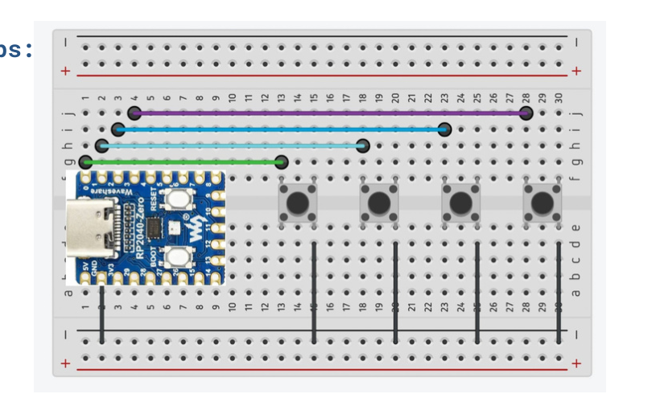

*Voorbeeld 1: Digitale pushbuttons*

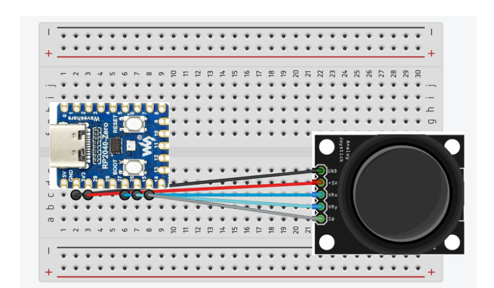

*Voorbeeld 2: Analoge joysticks (🤖 extra uitdaging!)*

---

## Les 3 - Van prototype naar ontwerp

💡 **Wat we deze les gaan doen**

1️⃣ Je prototype afmaken (zie les 2) en mooier maken met korte draadjes.

2️⃣ Uitleg over de code: bewerken, functies van de knopjes aanpassen.

3️⃣ Je eigen behuizing/knopjes maken met Tinkercad.

📢 **Mededelingen**

- ⏸️ Pauze van 15:15-16:30u
- 👩‍🔬 Experimenteren met de spullen in de koffer mag.
- 📷️ We willen foto's maken voor documentatie. Je blijft anoniem!

🏛️ **Alvast voor Les 4: de laatste les (14 oktober)**

- Je gamecontroller afmaken en laten zien aan elkaar
- Neem je favoriete spel mee, gamen met de gamecontroller
- Ideeën?

### De code

📖 Vorige week heb je de code kunnen downloaden. We gaan deze nu openen in de Code Editor.

1️⃣ Sluit je gamecontroller aan via USB

2️⃣ Ga naar de website: <https://code.circuitpython.org/>

3️⃣ Selecteer de controller (via het Web Serial menu)

4️⃣ Open de code (vanaf de usb)

▶️ Code testen. Klik op:

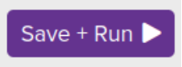

### Ontwerpen in Tinkercad

📖 Met Tinkercad kun je zelf een 3D-ontwerp maken. Deze kan met een 3D-printer worden geprint.

1️⃣ Ga naar de website van Tinkercad: [Breadboard Controller](https://www.tinkercad.com/things/gcZdTmQr3mL-breadboard-controller?sharecode=Ttn7LhJRwNyX932LWhHhHagjP_zzYuZGTG6vg903GLk)

2️⃣ Maak een account aan.

3️⃣ Je kunt nu het bestaande ontwerp aanpassen.

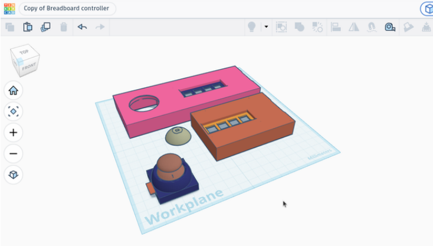

🤖 Als het lukt kun je jouw ontwerp sturen naar: <jw@creativecodingutrecht.nl>

Onderwerp: *Gamecontroller + naam*

Jonas en Joost gaan kijken of we deze kunnen 3D-printen voor de laatste les.
