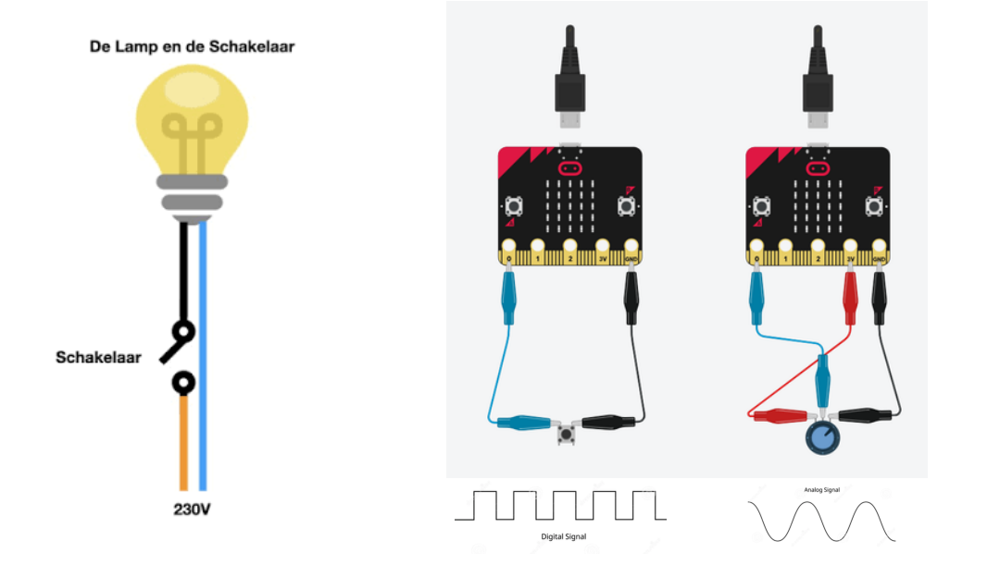

# 01 · Wat is een stroomkring?

> 🚧 **TODO:** voor deze stap is nog geen lesmateriaal. Hieronder staat alleen wat er al in het boekje zit.

## Wat ga je leren?

- TODO

## Startpunt uit het boekje

Een schakelaar maakt of verbreekt de stroomkring: net als een knop op je controller.

---

[Overzicht](../../README.md) · [Analoog vs. digitaal signaal](../02-analoog-digitaal/README.md) →
