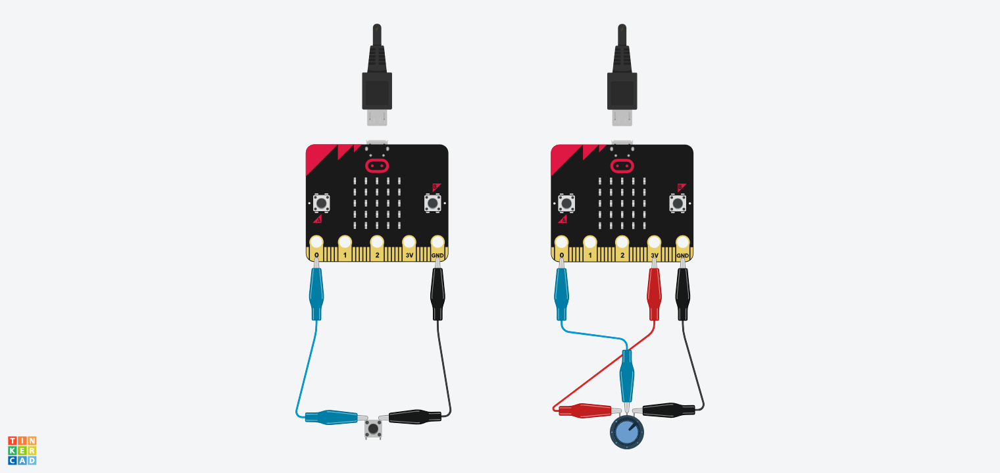
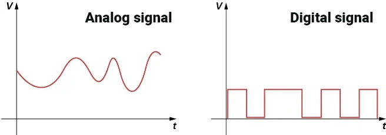
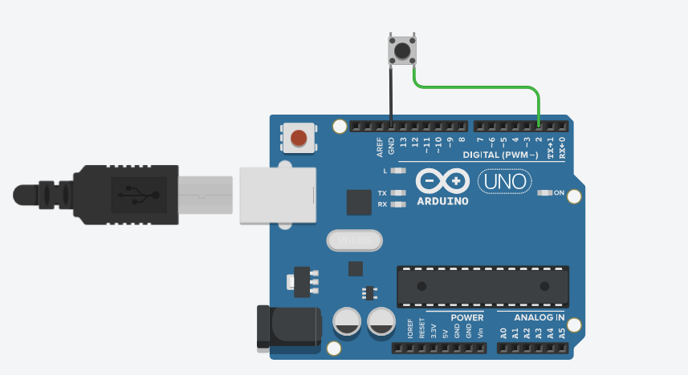
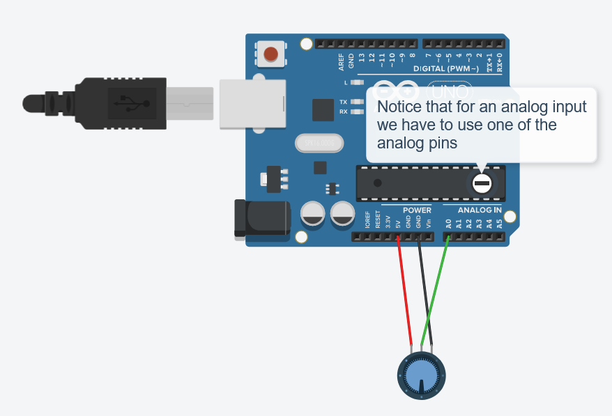

# 02 · Analoog vs. digitaal signaal

## Micro:bit

Een gamecontroller gebruikt digitale en analoge signalen. Hoe je een component uitleest, hangt af van het type signaal dat hij afgeeft.

### Digitaal signaal

Een **digitaal signaal** kent maar twee toestanden: aan of uit (1 of 0). Dit is perfect voor knoppen en schakelaars.

- **Voorbeeld**: [Knop (Push Button)](https://www.teachwithict.com/pushbtton.html)
- **Waarden**: `0` (laag/uit) of `1` (hoog/aan)
- **Resolutie**: 1 bit (2 mogelijke waarden)

### Analoog signaal

Een **analoog signaal** kan een continue reeks waarden hebben, meestal van 0 tot 1023. Dit is ideaal voor precieze controle, zoals met een potentiometer.

- **Voorbeeld**: [Potentiometer](https://www.teachwithict.com/potentiometer.html)
- **Waarden**: 0 t/m 1023 (hoe hoger de waarde, hoe verder de potentiometer is opengedraaid)
- **Resolutie**: 10 bits (2¹⁰ = 1024 mogelijke waarden)

### Ingebouwde sensoren van de Micro:bit

De Micro:bit heeft al veel ingebouwde invoer die je voor je controller kunt gebruiken:

- **2 knoppen** (A en B)
- **Accelerometer**: detecteert beweging en kanteling
- **Temperatuursensor**: meet de omgevingstemperatuur
- **Lichtsensor**: meet hoeveel licht er is
- **Kompas (magnetometer)**: detecteert de magnetische noordpool
- **Touch logo**: het gouden logo op de Micro:bit is ook een aanraaksensor

> Meer informatie over alle sensoren vind je op de [officiële Micro:bit website](https://microbit.org/get-started/features/sensors/).

🤖 **Extra (uit het boekje).** Wat voor signaal heeft een joystick? A) Analoog, B) Digitaal, C) Analoog & Digitaal

## Arduino

Anything can be an input for a controller! As long as it can be perceived by our Arduino as either an analog or a digital signal.

> 
>
> Third-party image, not covered by the CC BY 4.0 licence of this material.
>
> Both of the graphs show an electric signal (a change of voltage over time). 
> The analog signal is continuous: the voltage has a variety of different values. 
> The digital signal is discrete: it can only have two states (HIGH or LOW).

Arduino has two functions with which we can read the voltage on its pins:

- `digitalRead()`
  This will read the electric signal on the selected pin and interpret it as either a HIGH (1) or LOW (0) value, representing a binary signal (1 bit).
  This is ideal for inputs that behave like a "switch", such as a button in the case of our controller.

- `analogRead()`
  This will read the electric signal on the selected analog pin and interpret it as a number in the range of 0-1023 (a 10-bit integer).
  This is useful for components like joysticks and potentiometers (knobs).

---

← [Wat is een stroomkring?](../01-stroomkring/README.md) · [Overzicht](../../README.md) · [Je eerste code](../03-eerste-code/README.md) →
