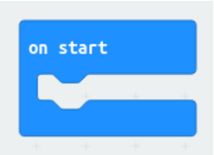
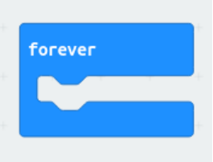
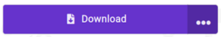

# 03 · Je eerste code

Je eerste code schrijf je op de **Micro:bit**, ook als je controller later een ander bord krijgt. Kun je al programmeren? Dan mag je deze stap zelf doorlopen of overslaan.

## De Micro:bit programmeren

👁️‍🗨️ Gebruik de Google Chrome browser

👁️‍🗨️ Stel de taal van de editor in op Engels

1️⃣ Ga naar: <https://makecode.microbit.org/>

2️⃣ Kies "New Project" en geef het een naam.

3️⃣ Ga naar: <https://microbit.org/projects/make-it-code-it/>

4️⃣ Maak de twee tutorials: "Heart" en "Beating heart".

❓ Wat doen volgens jou de "on start" en "forever" blokjes?

| Blokje | 📝 Wat doet het? |
| --- | --- |
|  | |
|  | |

## Code flashen: hoe zet je de code op de Micro:bit?

1️⃣ Klik op "download" in de Micro:bit omgeving. Je download nu jouw project naar de computer.

2️⃣ Sluit nu de Micro:bit aan op de computer met de USB-kabel.

3️⃣ Ga naar de File Explorer van je computer. Kopieer je bestand (`.hex`) naar de Micro:bit (usb). (Meestal vind je dit bestand in jouw Download-map.)

4️⃣ Het bestand staat nu op de Micro:bit en geeft de computerchips op de Micro:bit instructies.

❓ Reageert de Micro:bit op jouw code? Zo nee, kijk bij [Testen en debuggen](../12-testen-debuggen/README.md).

🤖 **Extra**

- Wat zie je als je het hex-bestand opent als tekstbestand?
- Kun je jouw code ook plaatsen via web-usb? (Download > Pair..)

---

← [Analoog vs. digitaal signaal](../02-analoog-digitaal/README.md) · [Overzicht](../../README.md) · [Kies en installeer je microcontroller](../04-bord-opzetten/README.md) →
