# 04 · Kies en installeer je microcontroller

⚠️ **Dit is een keuzemoment.** Het bord dat je hier kiest, bepaalt welke code, welke voorbeelden en welke installatiestappen je in de rest van de leerlijn volgt.

| | Bord | Moeilijkheid | Taal / omgeving | Verbinding |
| --- | --- | --- | --- | --- |
| 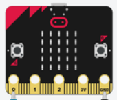 | [Micro:bit](#microbit-als-hid) (+ DragonTail) | ⭐ | MakeCode (blokjes) | 📶 Draadloos (Bluetooth) |
| 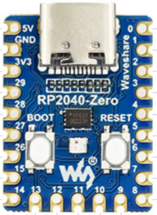 | [RP2040-Zero](#rp2040-zero-met-circuitpython) | ⭐⭐ | CircuitPython | 🔌 USB |
| 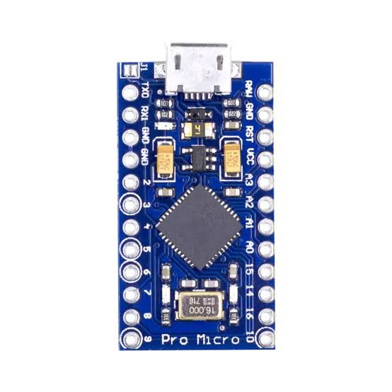 | [Pro Micro](#wired-pro-micro-with-hid-project) (ATmega32u4) | ⭐⭐⭐ | Arduino + HID-Project | 🔌 USB |
| 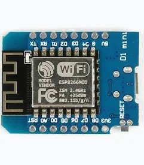 | [D1 mini ESP32](#wireless-esp32-with-bluetooth-ble) | ⭐⭐⭐ | Arduino + BLE-library | 📶 Draadloos (Bluetooth LE) |

<sub>Foto's Pro Micro en D1 mini ESP32: derden. Valt niet onder de CC BY 4.0-licentie van dit materiaal.</sub>

### Kan ik ook een ander bord gebruiken?

Ja, maar niet elk bord kan zich voordoen als toetsenbord of gamepad (*HID*). Hieronder staat welke borden werken.

<details>
<summary><b>Arduino via USB (HID-Project)</b></summary>

De voorbeelden gebruiken de library [HID-Project](https://github.com/NicoHood/HID). Die werkt alleen op borden die zelf een USB-apparaat kunnen zijn. Al deze borden kun je gebruiken:

- Arduino Leonardo, Arduino Micro en Pro Micro, en andere borden met een ATmega32u4, 32u2, 16u2, 8u2 of AT90USB8/162
- Arduino Zero, MKR1000 en andere borden met een SAMD21-chip
- Arduino Uno en Mega (R3), maar alleen nadat je [HoodLoader2](https://github.com/NicoHood/HoodLoader2) op hun USB-chip hebt gezet

❗️ Werkt **niet** met HID-Project: Arduino Nano en Pro Mini (ATmega328P), een gewone Uno zonder HoodLoader2, Arduino Due, en de Uno R4. De Uno R4 kan wel toetsenbord en muis zijn met de [ingebouwde Keyboard- en Mouse-library](https://docs.arduino.cc/tutorials/uno-r4-minima/usb-hid), maar dan heb je geen gamepad.

</details>

<details>
<summary><b>ESP32 via Bluetooth</b></summary>

Een library als [ESP32-BLE-Gamepad](https://github.com/lemmingDev/ESP32-BLE-Gamepad) werkt op vrijwel elk ESP32-bord met Bluetooth LE, dus ook op een ESP32 DevKit of borden met een ESP32-S3, -C3 of -C6.

❗️ Werkt **niet**: borden met een ESP32-S2 (geen Bluetooth) en de gewone D1 mini met een ESP8266 (geen Bluetooth en geen USB-HID). Let bij het kopen op "ESP32" in de naam.

</details>

<details>
<summary><b>CircuitPython via USB</b></summary>

De module `usb_hid` werkt alleen op chips met *native USB*:

- RP2040 en RP2350, zoals de RP2040-Zero, Raspberry Pi Pico en Pico 2, en de SparkFun Pro Micro RP2040
- SAMD21 en SAMD51, zoals de Adafruit QT Py M0 en Trinket M0
- ESP32-S2 en ESP32-S3
- nRF52840 (kan ook een Bluetooth-controller worden met de library `adafruit_ble`)
- STM32F4 en i.MX RT, zoals de Teensy 4.0 en 4.1

❗️ Werkt **niet** met `usb_hid`: de gewone ESP32 (ook de D1 mini ESP32), ESP32-C3, -C6 en -H2, en de ESP8266. Twijfel je over een bord? Zoek het op via [circuitpython.org/downloads](https://circuitpython.org/downloads) en kijk of `usb_hid` bij de *built-in modules* staat.

</details>

## Micro:bit als HID

Om de Micro:bit als game controller te gebruiken (een *Human Interface Device*, HID), voeg je de **microbit-hid** extensie toe aan MakeCode.

### Stap 1: Open de extensies

Klik op **"Extensions"** in het menu onderaan.

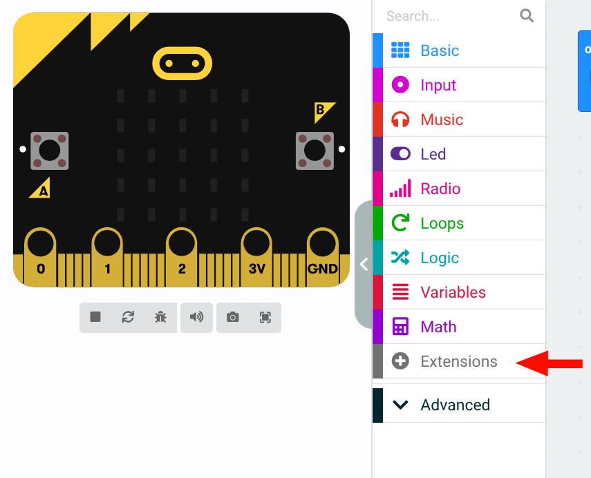

### Stap 2: Voeg de HID extensie toe

Typ de volgende URL in de zoekbalk:

```
https://michaelmcglothlin.github.io/microbit-hid/
```

Klik op de extensie om deze toe te voegen aan je project.

### Stap 3: Verwijder onnodige extensies

Sommige extensies kunnen conflicten veroorzaken. Klik op **"Remove extension"** om ongebruikte extensies te verwijderen.

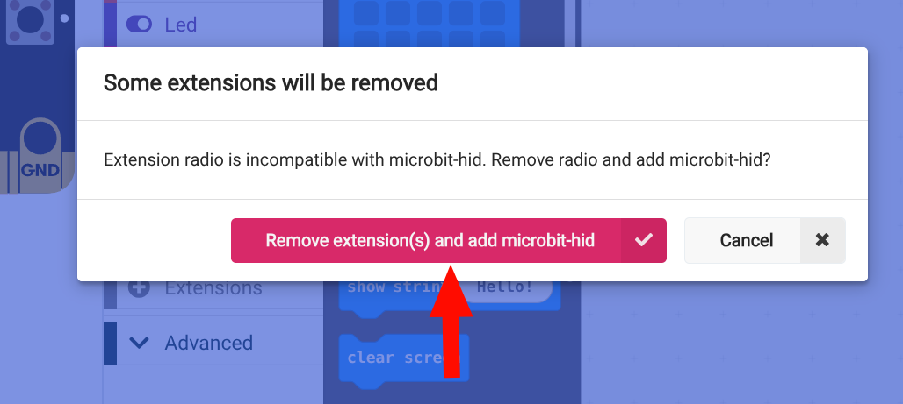

### Verbinden via Bluetooth

> 🚧 **TODO:** stappen om de Micro:bit via Bluetooth met de computer te koppelen.

## RP2040-Zero met CircuitPython

### De processor: het 🧠 van de controller

| 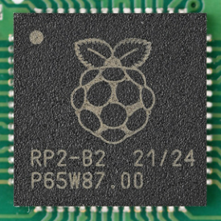 | 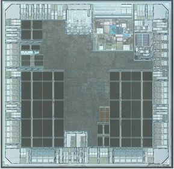 | 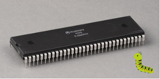 |
| --- | --- | --- |
| Dit is de processor | Zo ziet het er van binnen uit 🐛 | Voorbeeld: Motorola 68000 (1979) |

<sub>Afbeeldingen van derden. Vallen niet onder de CC BY 4.0-licentie van dit materiaal.</sub>

### Onderzoek de pinnen

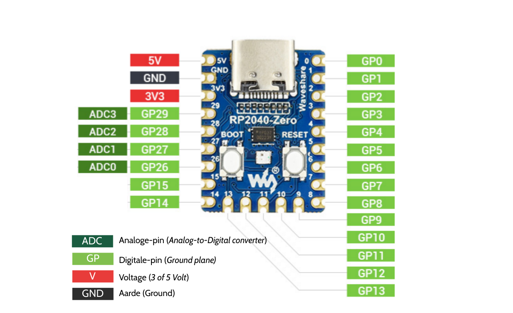

<sub>Gebaseerd op de pinout van Waveshare. Valt niet onder de CC BY 4.0-licentie van dit materiaal.</sub>

| Label | Betekenis |
| --- | --- |
| **ADC** | Analoge pin (*Analog-to-Digital Converter*) |
| **GP** | Digitale pin (*General Purpose* input/output) |
| **V** | Voltage (3 of 5 Volt) |
| **GND** | Aarde (*Ground*) |

1. Welke pinnen kun je gebruiken om de **analoge** besturing aan te sluiten?
2. Welke pinnen kun je gebruiken om de **digitale** besturing aan te sluiten?
3. Welke pin gebruik je om stroom op de Raspberry te zetten?
4. Hoe kun je ook stroom op de Raspberry zetten?

### Firmware flashen

Download de CircuitPython-firmware voor de RP2040-Zero: <https://circuitpython.org/board/waveshare_rp2040_zero/>

Houd de `BOOT`-knop ingedrukt en sluit de microcontroller via USB aan op je computer. Er verschijnt een USB-schijf met een naam zoals `RPI-RP2`.

Kopieer het gedownloade firmwarebestand naar deze schijf. De microcontroller start daarna automatisch opnieuw op. Na het herstarten verschijnt een nieuwe USB-schijf met de naam `CIRCUITPY`.

## Arduino

### Wired: Pro Micro with HID-Project

To be able to use our Arduino as a controller, we need to make it output a signal that can be perceived by our computer. Arduinos that support USB client mode (such as Arduino Pro Micro or Uno R4) can be used to emulate a Human Interface Device (HID). For our code examples, we use a library called HID-Project, which can make our Arduino be perceived as any of the following input devices:

Keyboard, Mouse, Gamepad, MIDI, Consumer (media player, browser, special programs), System (start/shutdown PC), Raw HID (create your own low-level HID device).

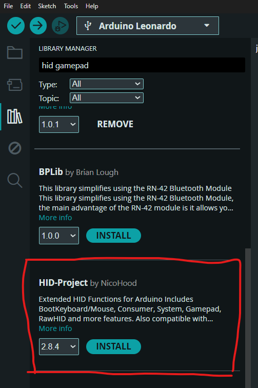

Wiki: <https://github.com/NicoHood/HID/wiki>

> 🚧 **TODO:** install steps: Arduino IDE, board package for the Pro Micro, installing *HID-Project* via the Library Manager.

### Wireless: ESP32 with Bluetooth (BLE)

If you want to experiment with a wireless controller, you can use an ESP32 board to create a Bluetooth HID device.

> ⚠️ Use an **ESP32** variant (for example the D1 mini ESP32). The classic D1 mini is an ESP8266: it has no Bluetooth and no native USB, so it can't act as a controller.
> HID-Project does not run on the ESP32; you need a BLE library instead (for example *ESP32-BLE-Gamepad* or *ESP32-BLE-Keyboard*).

> 🚧 **TODO:** install steps and a BLE example sketch.

---

← [Je eerste code](../03-eerste-code/README.md) · [Overzicht](../../README.md) · [Breadboard: prototype drukknop (digitaal)](../05-drukknop/README.md) →
