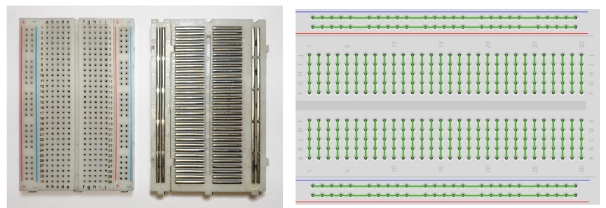
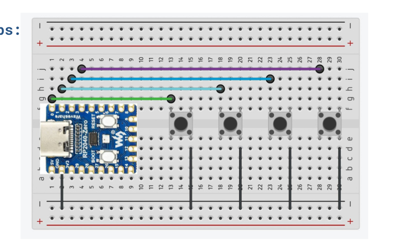

# 05 · Breadboard: prototype drukknop (digitaal)

Een knop geeft een **digitaal** signaal: ingedrukt of niet. Zie [Analoog vs. digitaal](../02-analoog-digitaal/README.md).

## Het breadboard

Afbeelding van derden. Valt niet onder de CC BY 4.0-licentie van dit materiaal.

👁️‍🗨️ Hier kun je zien hoe de gaatjes op het bordje (breadboard) zijn verbonden.

❗️ Let er bij het aansluiten van de draadjes op dat ze elkaar niet overbruggen.

## Knop op de Micro:bit

1️⃣ Ga naar deze website: <https://www.teachwithict.com/pushbtton.html>

2️⃣ Volg de instructies om een knopje aan te sluiten op de Micro:bit.

3️⃣ Programmeer het knopje. Gebruik het voorbeeld of geef het zelf een functie!

## Knoppen op de RP2040-Zero

Bouw voorbeeld 1. De code staat in [11-code/circuitpython/2_KEYBOARD](../11-code/circuitpython/2_KEYBOARD/code.py): knoppen op GP1 t/m GP4, de andere kant van elke knop aan GND.

## Button on the Arduino

Wire a button between a digital pin and GND, and read it with `digitalRead()` using `INPUT_PULLUP` (pressed = `LOW`).

Example: [11-code/arduino/button](../11-code/arduino/button/button.ino) types a message for every button press.

---

← [Kies en installeer je microcontroller](../04-bord-opzetten/README.md) · [Overzicht](../../README.md) · [Breadboard: prototype potmeter (analoog)](../06-potmeter/README.md) →
