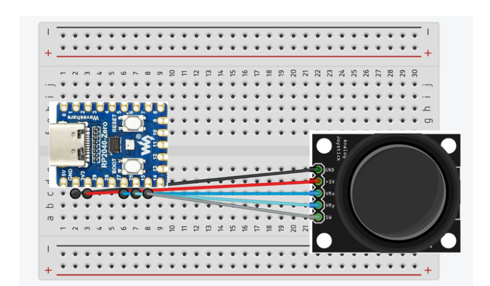

# 06 · Breadboard: prototype potmeter (analoog)

Een potentiometer (draaiknop) of joystick geeft een **analoog** signaal: een waarde in een bereik. Zie [Analoog vs. digitaal](../02-analoog-digitaal/README.md).

## Potentiometer op de Micro:bit

1️⃣ Ga naar deze website: <https://www.teachwithict.com/potentiometer.html>

2️⃣ Volg de instructies om een potentiometer aan te sluiten op de Micro:bit.

3️⃣ Programmeer de potentiometer. Gebruik het voorbeeld of jouw creativiteit!

## Joystick op de RP2040-Zero

Alleen **GP26 t/m GP29** zijn analoge pinnen (ADC0 t/m ADC3), zie de [pinout](../04-bord-opzetten/README.md#onderzoek-de-pinnen).

Bouw voorbeeld 2. De code staat in [11-code/circuitpython/1_GAMEPAD](../11-code/circuitpython/1_GAMEPAD/code.py): de joystick-assen op GP26 en GP27, de drukknop van de joystick op GP15.

## Potentiometer or joystick on the Arduino

Connect the middle pin of the potentiometer (or a joystick axis) to an analog pin (`A0`…) and the outer pins to VCC and GND. Read it with `analogRead()` (0-1023).

Examples: [11-code/arduino/HID-gamepad](../11-code/arduino/HID-gamepad/HID-gamepad.ino) (one axis) and [11-code/arduino/joystick](../11-code/arduino/joystick/joystick.ino) (two axes + press).

---

← [Breadboard: prototype drukknop (digitaal)](../05-drukknop/README.md) · [Overzicht](../../README.md) · [Bedenk je eigen input signaal](../07-eigen-input/README.md) →
