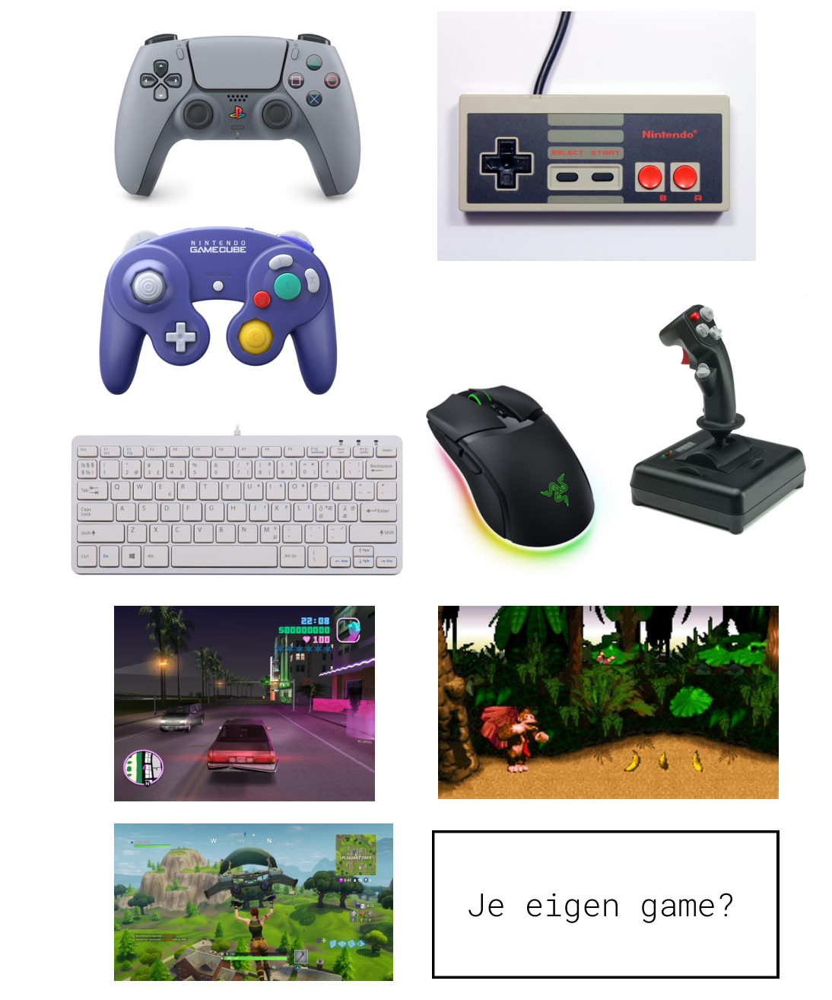

# 08 · Schets je controller en pitch je idee

## Inspiratie

> Tip: kijk naar bestaande controllers (PlayStation, Xbox, Nintendo) voor inspiratie, maar bedenk dat jij zelf bepaalt wat handig is!

## Schetsen op papier

Begin met schetsen van je controller-ontwerp:

- **Welke knoppen** heb je nodig voor je game?
- **Waar komen de knoppen** op de controller? (ergonomisch)
- **Heb je een joystick** of draaiknoppen (potentiometers) nodig?
- **Hoe houd je het bord** (Micro:bit, RP2040-Zero, Pro Micro…) vast in je ontwerp?

## Klassikale presentatie

Iedereen presenteert zijn/haar idee kort aan de klas:

- Laat je schetsen zien
- Leg uit **voor welke game** je controller is
- Leg uit **waarom** je voor deze knoppen/indeling hebt gekozen
- Vraag om feedback van je klasgenoten

---

← [Bedenk je eigen input signaal](../07-eigen-input/README.md) · [Overzicht](../../README.md) · [Circuit simuleren in Tinkercad](../09-circuit-simuleren/README.md) →
