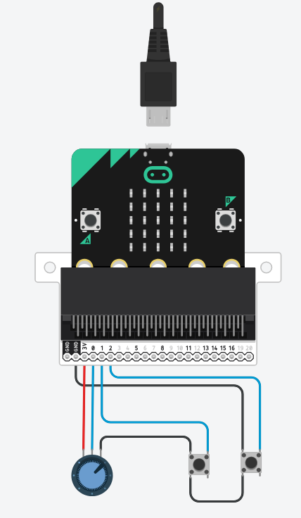

# 09 · Circuit simuleren in Tinkercad

We gebruiken **Tinkercad Circuits** om het circuit te simuleren voordat we het fysiek bouwen.

> Tinkercad Circuits kent de Micro:bit en de Arduino Uno, maar niet de RP2040-Zero of de Pro Micro. Werk je met een van die borden, dan sla je deze stap over.

## Aan de slag met Tinkercad

1️⃣ Ga naar [Tinkercad](https://www.tinkercad.com/dashboard) en log in

2️⃣ Klik op **Create > Circuits**

3️⃣ Start een nieuw project

## Bouw je circuit

Plaats in de simulatie:

- Micro:bit
- Drukknoppen → digitale pinnen
- Potentiometers → analoge pinnen

## Aansluiten met de DragonTail

De **DragonTail** is een uitbreidingsboard dat het makkelijker maakt om componenten aan te sluiten op de Micro:bit. Je sluit de Micro:bit aan op de DragonTail, en daarna kun je componenten aansluiten op de gemarkeerde pinnen.

### Pinout van de Micro:bit

Let bij het aansluiten van componenten op de volgende pinout:

> **Belangrijk:** niet alle pinnen zijn gelijk! Sommige pinnen hebben speciale functies en beperkingen.

Kijk ook op [microbit.pinout.xyz](https://microbit.pinout.xyz/) voor een interactief overzicht.

> **Meer analoge pinnen:** P3, P4 en P10 kunnen ook als **analoge input** gebruikt worden, maar alleen als je het LED display uitschakelt met de functie `display.disable()`. Dit geeft je in totaal **6 analoge pinnen** (P0, P1, P2, P3, P4, P10).
>
> Let op: als je het display uitschakelt, werkt ook de **lichtsensor** niet meer (die gebruikt de LED-matrix als sensor). Je kunt het display later weer inschakelen met `display.enable()`.
>
> De LED-matrix heeft weerstanden verbonden aan deze pinnen: houd hier rekening mee bij het ontwerp van je circuit.
>
> **Bron:** Micro:bit Educational Foundation - [Edge Connector & Pinout](https://tech.microbit.org/hardware/edgeconnector/#pins-and-signals)

---

← [Schets je controller en pitch je idee](../08-schetsen-pitch/README.md) · [Overzicht](../../README.md) · [Breadboard: maak een prototype voor je circuit](../10-prototype-circuit/README.md) →
