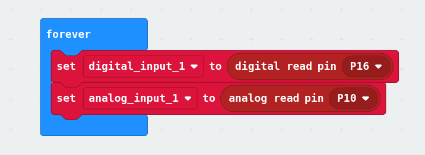
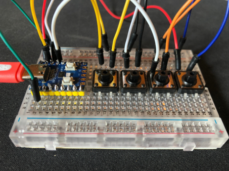

# 10 · Breadboard: maak een prototype voor je circuit

Bouw alle knoppen en sensoren uit je [schets](../08-schetsen-pitch/README.md) samen op één breadboard.

## Micro:bit: van simulatie naar realiteit

Bouw het circuit uit [Tinkercad](../09-circuit-simuleren/README.md) na op het breadboard. Controleer of alle componenten correct aangesloten zijn en of de signalen goed doorkomen.

### Extra: meer knoppen met de DragonTail

Via de DragonTail kun je extra knoppen en sensoren aansluiten op de Micro:bit. Zo lees je ze uit:

## Het prototype op de RP2040-Zero

1️⃣ Begin met het bouwen van het eerste voorbeeld ([drukknoppen](../05-drukknop/README.md#knoppen-op-de-rp2040-zero)).

2️⃣ Gelukt? Voeg dan de rest van je knoppen toe, en een [joystick](../06-potmeter/README.md#joystick-op-de-rp2040-zero) als je durft (🤖 extra uitdaging!).

3️⃣ Maak je prototype mooier met korte draadjes.

## Arduino

Combine the buttons, analog inputs and [your own sensors](../07-eigen-input/README.md) on one breadboard. Keep track of which pin goes where: you need that list for the code.

---

← [Circuit simuleren in Tinkercad](../09-circuit-simuleren/README.md) · [Overzicht](../../README.md) · [Code: je controller programmeren](../11-code/README.md) →
