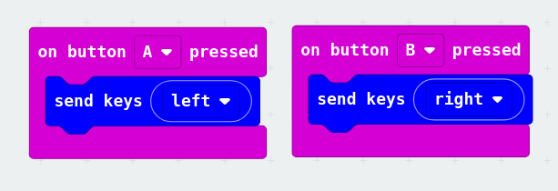
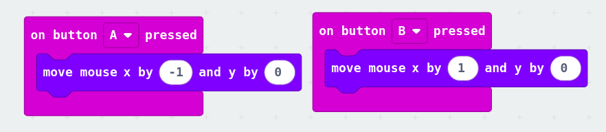
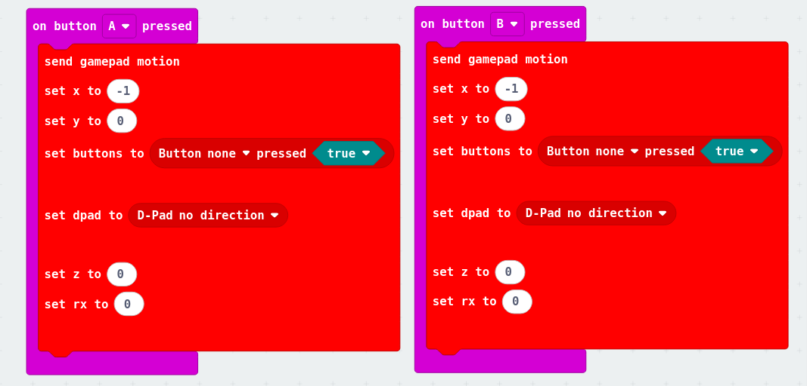
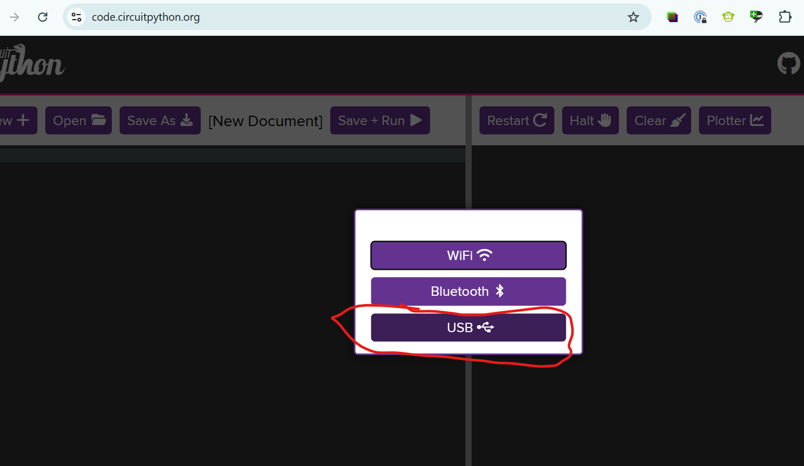
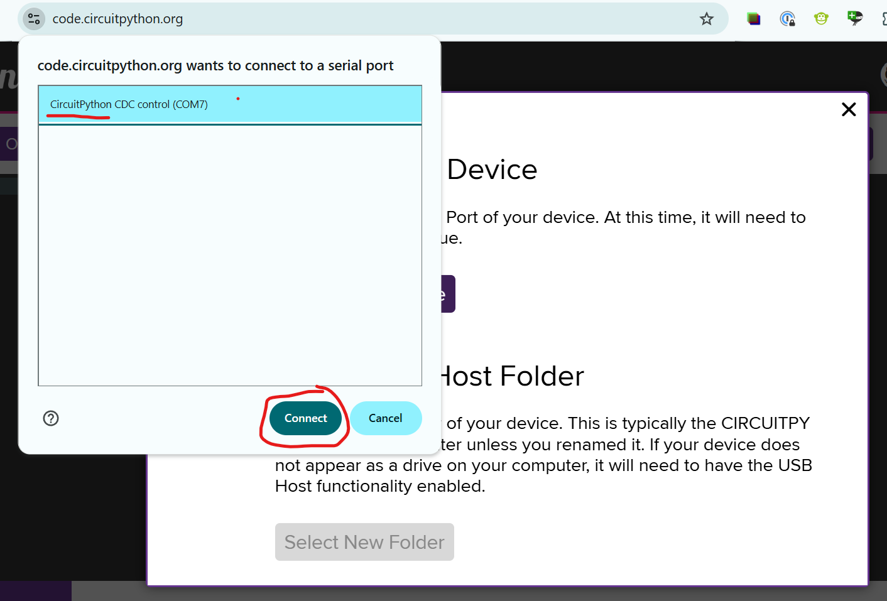
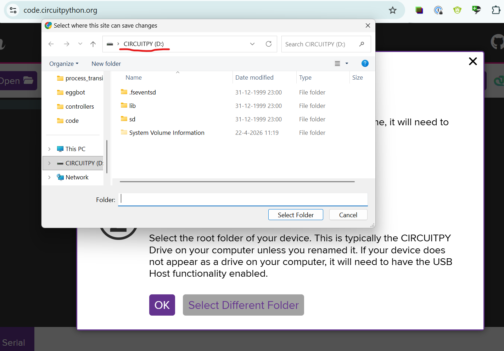

# 11 · Code: je controller programmeren

## Micro:bit (MakeCode)

Je hebt de HID-extensie al toegevoegd in [stap 04](../04-bord-opzetten/README.md#microbit-als-hid). Begin met het keyboard-template: laat een knop een toets indrukken.

Wil je meer? Je kunt de Micro:bit ook een muis laten besturen of gamepad-inputs laten sturen:

## RP2040-Zero (CircuitPython)

Je hebt CircuitPython al op het bord gezet in [stap 04](../04-bord-opzetten/README.md#firmware-flashen).

### 1. Een voorbeeld uploaden

Kies een van deze voorbeelden:

- [circuitpython/1_GAMEPAD](./circuitpython/1_GAMEPAD): 2 knoppen + analoge joystick als gamepad
- [circuitpython/2_KEYBOARD](./circuitpython/2_KEYBOARD): 4 knoppen als pijltjestoetsen

Sleep de inhoud van de gekozen map naar de `CIRCUITPY`-schijf. Overschrijf bestaande bestanden als daarom gevraagd wordt.

### 2. Code aanpassen

Open <https://code.circuitpython.org/> in Chrome of een andere Chromium-browser. Firefox en Safari ondersteunen dit niet, omdat je WebUSB nodig hebt.

Verbind de microcontroller via USB met de computer.

Selecteer het CircuitPython-apparaat in de dropdown.

Selecteer daarna je CircuitPython-apparaat als host folder en open `code.py` om de code aan te passen.

▶️ Code testen? Klik op:

Wil je andere toetsen koppelen aan je knoppen? Bekijk het [Keycode-overzicht](./KEYCODES.md).

## Arduino

### Pro Micro (HID-Project)

| Example | Shows |
| --- | --- |
| [arduino/button](./arduino/button/button.ino) | Keyboard: a list of buttons, each types its own message |
| [arduino/HID-gamepad](./arduino/HID-gamepad/HID-gamepad.ino) | Gamepad: one button + one analog axis |
| [arduino/joystick](./arduino/joystick/joystick.ino) | Mouse: a joystick moves the cursor (`AbsoluteMouse`), press = left click |

> 🚧 **TODO:** MIDI example (HID-Project doesn't do MIDI itself; for example use the *MIDIUSB* library).

### ESP32 (BLE)

> 🚧 **TODO:** BLE gamepad/keyboard example, see [04-bord-opzetten](../04-bord-opzetten/README.md#wireless-esp32-with-bluetooth-ble).

---

← [Breadboard: maak een prototype voor je circuit](../10-prototype-circuit/README.md) · [Overzicht](../../README.md) · [Testen en debuggen](../12-testen-debuggen/README.md) →
