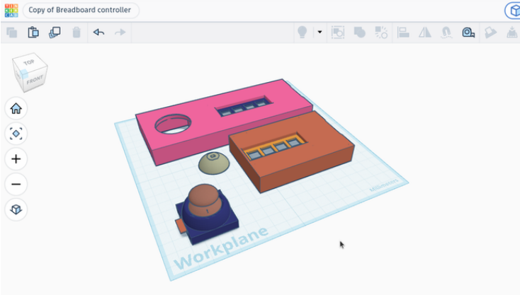

# 13 · Tinkercad: ontwerp je behuizing

📖 Met Tinkercad kun je zelf een 3D-ontwerp maken. Dat ontwerp kan met een 3D-printer worden geprint.

## Een bestaand ontwerp pimpen (soldeerloos)

1️⃣ Ga naar de website van Tinkercad: [Breadboard Controller](https://www.tinkercad.com/things/gcZdTmQr3mL-breadboard-controller?sharecode=Ttn7LhJRwNyX932LWhHhHagjP_zzYuZGTG6vg903GLk)

2️⃣ Maak een account aan.

3️⃣ Je kunt nu het bestaande ontwerp aanpassen.

Een 3D-model van de Micro:bit, om je behuizing op te laten passen: [Micro:bit 3D model](https://www.tinkercad.com/things/0O5Lksq72nO-microbit)

🤖 Gelukt? Laat je ontwerp aan je docent zien. Misschien kunnen we het 3D-printen.

## Ontwerp voor solderen

> 🚧 **TODO:** een behuizing ontwerpen voor een gesoldeerde controller: maten van het bord en de knoppen, gaten voor de USB-kabel, en ruimte voor draden.

Houd rekening met [toleranties](../15-3d-printen/README.md#toleranties) als onderdelen in elkaar moeten passen.

---

← [Testen en debuggen](../12-testen-debuggen/README.md) · [Overzicht](../../README.md) · [Eigen 3D-pakket, bijv. Blender](../14-eigen-3d-pakket/README.md) →
